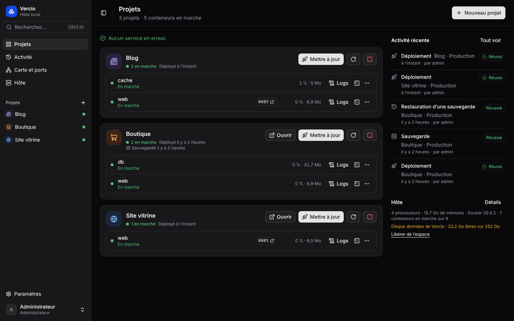
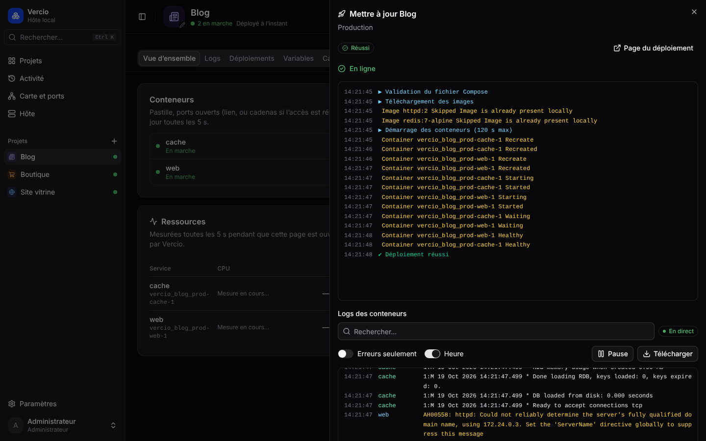
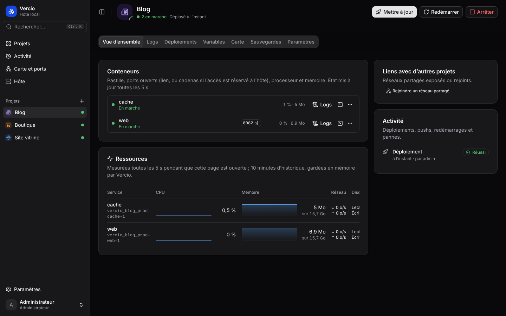
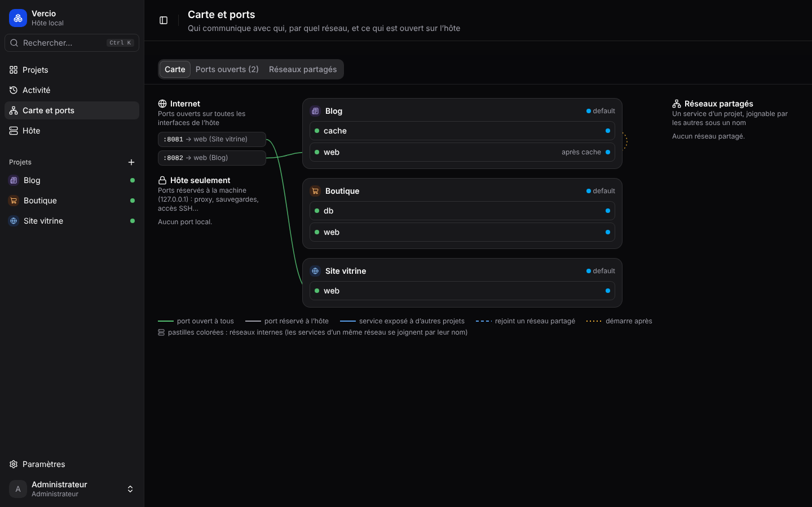
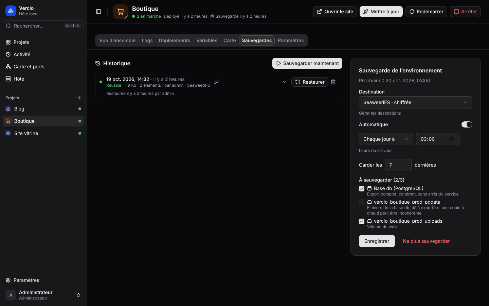

# Vercio

A web interface to deploy and monitor your Docker Compose projects, on your own server.

You push code, your CI builds the image, Vercio deploys it. You see at a glance what is running and what is failing, and you can go back to the previous version in one click.

Vercio is made for small teams hosting a few websites or APIs on a server who want something better than an SSH terminal, without setting up Kubernetes.

> The interface is in French for now. Menu names below are given in French, with their meaning.



<table>
  <tr>
    <td></td>
    <td></td>
  </tr>
  <tr>
    <td align="center">Update followed live</td>
    <td align="center">Containers and resources of a project</td>
  </tr>
  <tr>
    <td></td>
    <td></td>
  </tr>
  <tr>
    <td align="center">Map of traffic and ports</td>
    <td align="center">Backups</td>
  </tr>
</table>

## Features

- **Deployment** from GitLab, GitHub or any registry: by branch, by tag, or automatically after each successful build (webhook).
- **Rollback** in one click, and automatic rollback when a deployment fails.
- **Zero-downtime updates** for the services that allow it.
- **Container monitoring**: state, health, open ports, CPU and memory, live logs, terminal in the browser.
- **Map** of the traffic between containers and of the ports exposed to the Internet.
- **Environment variables**, encrypted, per project and per environment (production, staging…).
- **Backups** of databases (PostgreSQL, MySQL, MariaDB, MongoDB) and volumes to S3 or a folder: encrypted, scheduled, restorable from the interface. Vercio also backs itself up.
- **Notifications** by email, Microsoft Teams or webhook.
- **Accounts** with mandatory two-factor authentication, three roles, and optional Keycloak SSO (OpenID Connect).

Vercio does not manage the reverse proxy, certificates or image builds: it relies on what you already have.

## Installation

You need a server with Docker (and the Compose plugin), and a reverse proxy to serve Vercio over HTTPS.

```sh
mkdir vercio && cd vercio
curl -fsSLO https://raw.githubusercontent.com/SitpiRajendran/Vercio/main/docker-compose.yml
curl -fsSLO https://raw.githubusercontent.com/SitpiRajendran/Vercio/main/install.sh
sh install.sh
```

<details>
<summary>Without curl</summary>

With wget, replace the two `curl` lines with:

```sh
wget https://raw.githubusercontent.com/SitpiRajendran/Vercio/main/docker-compose.yml
wget https://raw.githubusercontent.com/SitpiRajendran/Vercio/main/install.sh
```

With neither, let Docker download them:

```sh
docker run --rm -v "$PWD:/w" -w /w alpine:3.20 wget \
  https://raw.githubusercontent.com/SitpiRajendran/Vercio/main/docker-compose.yml \
  https://raw.githubusercontent.com/SitpiRajendran/Vercio/main/install.sh
```

You can also copy [`docker-compose.yml`](docker-compose.yml) and [`.env.example`](.env.example) by hand, save the second one as `.env`, fill it in, then run `docker compose up -d`.

</details>

The script asks for the public address of Vercio, generates a `.env` file with random secrets and starts Vercio on `127.0.0.1:9000`. Then open the public address: the first page creates the administrator account, using the setup code printed by the script.

Point your reverse proxy to `127.0.0.1:9000`. It must let WebSockets through (terminal) and must not buffer responses (live logs).

<details>
<summary>Example with nginx</summary>

```nginx
map $http_upgrade $connection_upgrade {
    default upgrade;
    ''      close;
}

server {
    server_name vercio.example.com;
    # listen 443 ssl; certificates…

    location / {
        proxy_pass http://127.0.0.1:9000;
        proxy_http_version 1.1;
        proxy_set_header Upgrade $http_upgrade;
        proxy_set_header Connection $connection_upgrade;
        proxy_set_header Host $host;
        proxy_set_header X-Forwarded-For $proxy_add_x_forwarded_for;
        proxy_set_header X-Forwarded-Proto $scheme;
        proxy_read_timeout 1h;
    }
}
```

</details>

> **Warning**: Vercio controls Docker, which amounts to root access on the server. Do not expose it unprotected: ideally keep it behind a VPN or an IP allowlist.

### Updating Vercio

When a new version is published, Vercio shows it at the bottom of the sidebar. An administrator can update from there in one click: Vercio backs up its database first (to the Vercio backup destination if one is set, otherwise to its data folder), restarts on the new version, and goes back to the previous one if the new one does not start. Your sites keep running during the update.

To update by hand instead:

```sh
docker compose pull && docker compose up -d
```

Images are published to `ghcr.io/sitpirajendran/vercio` (amd64 and arm64). To stay on a given version, set for example `VERCIO_TAG=v0.2.1` in `.env`. What changed in each version is listed in the [changelog](CHANGELOG.md) and on the [releases page](https://github.com/SitpiRajendran/Vercio/releases).

## Configuration

Everything is set in the `.env` file next to `docker-compose.yml`. After a change: `docker compose up -d`.

| Variable                                              | Purpose                                                               |
| ----------------------------------------------------- | --------------------------------------------------------------------- |
| `PUBLIC_URL`                                          | Public address of Vercio, for example `https://vercio.example.com`    |
| `VERCIO_SECRET_KEY`                                   | Key that encrypts stored secrets. **Keep a copy outside the server.** |
| `DB_PASSWORD`                                         | Password of Vercio's own database                                     |
| `VERCIO_SETUP_CODE`                                   | Code asked when creating the first administrator account              |
| `TZ`                                                  | Time zone of scheduled backups (`Europe/Paris` by default)            |
| `TRUST_PROXY`                                         | Number of reverse proxies in front of Vercio (`1` by default)         |
| `VERCIO_ADMIN_USERNAME`, `VERCIO_ADMIN_PASSWORD`      | Create the first administrator at startup, without the setup page     |
| `OIDC_ISSUER`, `OIDC_CLIENT_ID`, `OIDC_CLIENT_SECRET` | SSO login (optional, see below)                                       |
| `OIDC_PROVIDER_NAME`                                  | Name shown on the SSO login button (`Keycloak` by default)            |
| `OIDC_ROLES_CLAIMS`                                   | Where roles are read in the SSO token (see below)                     |
| `VERCIO_LOCAL_AUTH`                                   | `false` to allow SSO only                                             |
| `VERCIO_TAG`                                          | Image version to run (`latest` by default)                            |
| `VERCIO_UPDATE_CHECK`                                 | `false` to stop checking GitHub for new versions                      |
| `VERCIO_PORT`                                         | Local port Vercio listens on (`9000` by default)                      |

## Usage

1. **Paramètres → Code et images** (Settings → Code and images): connect GitLab or GitHub with a token. The matching image registry is added automatically.
2. **Nouveau projet** (New project): pick the repository and the Compose file, or paste it. Vercio finds the images built by your CI.
3. **Mettre à jour** (Update) deploys the chosen version. The deployment log is shown live, then the container logs.
4. For automatic updates, add the webhook shown in the project's **Webhooks** tab (Vercio can create it for you on GitLab or GitHub). If Vercio is not reachable from the Internet, simply turn webhooks off in the settings.

### Accounts and roles

Administrators create accounts in **Paramètres → Utilisateurs** (Settings → Users). Everyone sets up two-factor authentication at their first login.

| Role              | Can…                                           |
| ----------------- | ---------------------------------------------- |
| `vercio-admin`    | do everything, including settings and accounts |
| `vercio-deployer` | deploy, restart, edit variables, read logs     |
| `vercio-viewer`   | read                                           |

<details>
<summary>Setting up SSO with Keycloak</summary>

Local accounts and SSO work together: the login page offers both.

1. In your realm, create a confidential OpenID Connect client `vercio` with only the _Standard flow_:
   - _Valid redirect URIs_: `https://vercio.example.com/api/auth/oidc/callback`
   - _Valid post logout redirect URIs_: `https://vercio.example.com/connexion`
   - _Backchannel logout URL_: `https://vercio.example.com/api/auth/oidc/backchannel-logout` (with _Backchannel logout session required_)
   - _Advanced → Proof Key for Code Exchange_: `S256`
2. In the client's _Roles_ tab, create `vercio-admin`, `vercio-deployer` and `vercio-viewer`, and assign them to your users or groups. Without one of these roles, login is refused.
3. Add `OIDC_ISSUER` (for example `https://keycloak.example.com/realms/my-realm`), `OIDC_CLIENT_ID` and `OIDC_CLIENT_SECRET` to `.env`, then run `docker compose up -d`.

Roles are read again at each login. Vercio looks for them in the client roles, the realm roles and top-level groups (a `/vercio-admin` group grants the `vercio-admin` role; a subgroup such as `/team/vercio-admin` does not). `OIDC_ROLES_CLAIMS` changes where they are read from. If Keycloak uses a certificate from an internal authority, add it with a `docker-compose.override.yml` next to `docker-compose.yml`:

```yaml
services:
  vercio:
    environment:
      NODE_EXTRA_CA_CERTS: /etc/vercio/ca.pem
    volumes:
      - ./ca.pem:/etc/vercio/ca.pem:ro
```

</details>

### Backups

Add a destination in **Paramètres → Sauvegardes** (Settings → Backups), an S3 bucket or a folder, then configure each project in its **Sauvegardes** tab. On the same settings page, also turn on the backup of Vercio itself.

If you encrypt backups, write the passphrase down somewhere else: without it they cannot be read. To decrypt a file without Vercio:

```sh
docker run --rm -i -v "$PWD:/w" ghcr.io/sitpirajendran/vercio \
  node dist/cli.js decrypt-backup /w/db.sql.gz.enc /w/db.sql.gz
```

<details>
<summary>Restoring Vercio by hand (if it no longer starts)</summary>

Download the Vercio backup (the file is already decrypted), then, with the same `VERCIO_SECRET_KEY` in `.env`:

```sh
docker compose stop vercio
(echo 'DROP SCHEMA IF EXISTS drizzle CASCADE; DROP SCHEMA public CASCADE; CREATE SCHEMA public;'; gunzip -c vercio-YYYY-MM-DD-vercio.sql.gz) \
  | docker compose exec -T db psql -v ON_ERROR_STOP=1 --single-transaction -U vercio vercio
docker compose start vercio
```

The first line empties the database so that the backup is restored exactly, even if it was made by an older version; Vercio upgrades it when it starts. Everything happens in one transaction: if the import fails, the database is left as it was.

</details>

### Emergency access

If an administrator loses their phone or password, another administrator can reset it. Otherwise, from the server:

```sh
docker compose exec vercio node dist/cli.js reset-totp <username>
docker compose exec vercio node dist/cli.js reset-password <username>
```

## Contributing

Contributions are welcome: bug reports, ideas, fixes. For a significant change, please open an issue first to discuss it.

You need Node.js 24, Docker and pnpm (through Corepack: `npm install -g corepack@latest && corepack enable`).

```sh
pnpm install
docker compose -f docker-compose.dev.yml up -d   # development database
cp apps/server/.env.example apps/server/.env
pnpm dev                                         # API on :9000, interface on :9001
```

On first launch, the setup code is `vercio-dev-setup`.

| Command                                      | Effect                                                           |
| -------------------------------------------- | ---------------------------------------------------------------- |
| `pnpm dev`                                   | Server and interface with live reload                            |
| `pnpm test`                                  | Tests (API tests need `TEST_DATABASE_URL`, a throwaway database) |
| `pnpm lint`, `pnpm typecheck`, `pnpm format` | Checks and formatting                                            |
| `pnpm --filter @vercio/server db:generate`   | New migration after a schema change                              |

The code is organised in three parts:

```
apps/server       API (Fastify, PostgreSQL with Drizzle, Docker control)
apps/web          Interface (React, Vite, shadcn/ui)
packages/shared   Shared types and validation
```

## License

[AGPL-3.0](LICENSE)
